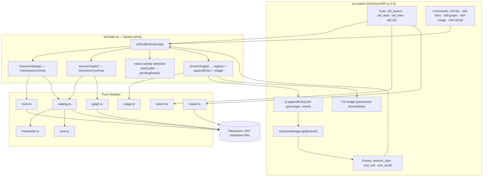
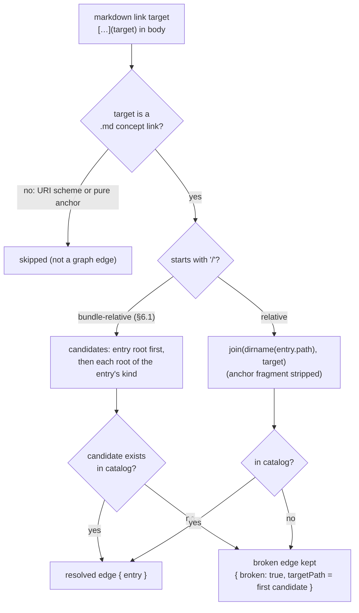
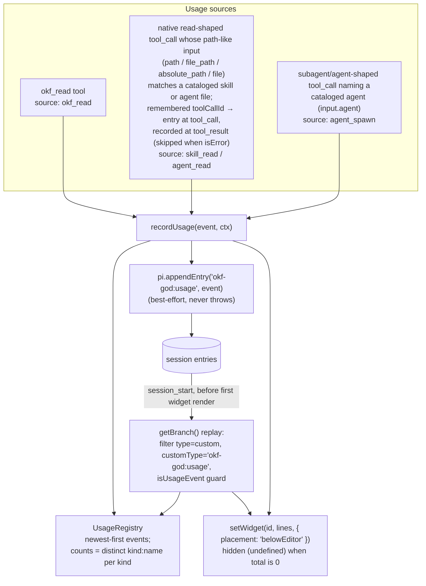

# Architecture

Implementation notes for the okf-god pi extension: how the pieces fit, what each module owns, and
the decisions behind the shape. The user-facing surface is documented in the
[README](../README.md); this document verifies the design against the code (`src/`, 9 modules,
~1,700 lines).

## Design principles

1. **Lazy everything.** The default-export factory (`src/index.ts`) registers tools, commands, and
   event handlers and does *no* filesystem work. The catalog and the link graph are memoized
   promises (`ensureCatalog` / `ensureGraph`) built on first use or after `session_start`. No
   scans, watchers, or timers run in the factory body. A failed build resets its memo so the next
   call retries instead of caching the rejection.
2. **Frontmatter-only indexing.** `scanCatalog` reads and retains frontmatter only — never bodies.
   Bodies are loaded strictly on demand by `okf_read` → `readResource`.
3. **Permissive conformance (OKF §11).** Nothing is ever rejected: unknown fields and types are
   ignored, missing frontmatter yields a minimal entry, broken links are kept as edges, and
   malformed lifecycle values fall back to safe defaults.
4. **Thin wiring.** `src/index.ts` owns only orchestration: memoization, resolution, formatting,
   and pi-API glue. All parsing, trust derivation, ranking, graph logic, and persistence live in
   pure, independently tested modules.
5. **Defensive handlers.** Every tool `execute`, command handler, and event handler is wrapped so a
   failure degrades to a warning notification or an error text result — it never crashes the
   session. Widget and `appendEntry` failures are swallowed by design.

## Component map



## Module reference

All export names below are verified against `grep '^export' src/*.ts`.

| Module | Exports | Role |
| --- | --- | --- |
| `frontmatter.ts` | `parseFrontmatter`, `FrontmatterResult` | Parses a leading `---` YAML block. Result is `{ ok: true, data, body }` or `{ ok: false, error }` — it **never throws**. Handles a leading BOM, CRLF delimiters, and empty blocks (→ `{}`); non-map roots are an error result, per §11. |
| `trust.ts` | `deriveTrustTier`, `isStale`, `normalizeStatus`, `normalizeVerifiedList`, `TrustTier` | OKF §5 trust & lifecycle. `deriveTrustTier`: absent/unusable → `unverified`; any `human:<id>` verifier → `human-reviewed`; else any verifier → `machine-confirmed`; a bare `{ by, at }` mapping is normalized to a one-element list (§5.2). `isStale`: `now >= stale_after`, unparseable values never stale. `normalizeStatus`: absent/empty → `stable`, producer strings kept as-is. |
| `catalog.ts` | `scanCatalog`, `CatalogCache`, `buildEntry`, `entryIsStale`, `readString`, `readMap`, `readTags`, `CATALOG_KINDS`, `EXCLUDED_SEGMENTS`, `RESERVED_FILENAMES`, types `CatalogEntry`, `CatalogKind`, `CatalogRoots`, `ScanOptions`, `CatalogCacheStat`, `TrustTier` | Recursive per-kind walk. Skips hidden dirs, `node_modules/`, `99-archive/`, config `exclude` segments, and reserved `index.md`/`log.md` (§3.1); only `.md` files; skills only `SKILL.md`. Name resolution: skill → frontmatter `name` else directory name (degenerate root-level `SKILL.md` → root basename); agent → `name` else filename slug; doc → filename slug. Duplicates keyed `kind:name`, **first wins**. Extracts `okfType` (`type`), `resource`, `staleAfter`, `generatedAt` (`generated.at`), `trustTier` (`verified`), `section`, `root`. `CatalogEntry.status`/`trustTier` are optional **only at the type level** (so hand-built test/tooling entries type-check); `scanCatalog` always populates them via `buildEntry`. `CatalogCache` reuses parsed entries while `{mtimeMs, size}` is unchanged. |
| `roots.ts` | `defaultRoots`, `resolveRoots`, `loadConfig`, `configExclude`, `OkfConfig` | Default roots mirror pi's discovery: skill `<cwd>/.pi/skills`, `<cwd>/.agents/skills`, `~/.pi/agent/skills`, `~/.agents/skills`; doc `<cwd>/docs`; agent `<cwd>/.pi/agents`, `~/.pi/agent/agents`, `~/.agents` (project pi-native first, Agent Skills/agents spec locations last). `loadConfig` reads `<cwd>/.pi/okf.json` then `~/.pi/agent/okf.json` (first existing wins); `resolveRoots` overrides a kind only when its array is non-empty, expands `~`, and resolves relative paths against cwd. Missing/malformed config is ignored. |
| `search.ts` | `searchEntries`, `tokenize`, `DEFAULT_SEARCH_LIMIT`, `SearchMatch`, `SearchOptions` | Weighted ranking: tags ×3, name ×2.5 (whole-token exact), title ×2, description/section ×1 (token prefix), summed per query token. Predicate split: **identity fields (tags/name) own exact words**; prose fields contribute prefix (inflection) hits, and an exact-word prose hit is suppressed when an identity field already claimed that token. This set is contract-derived and documented in the `src/search.ts` doc comment. Zero-token queries match nothing; results sort by score desc, capped at 8. |
| `reader.ts` | `readResource`, `DEFAULT_MAX_CHARS`, `ReadResult` | Reads a body, truncating to `maxChars` (default 20000). Truncated output ends with an explicit marker naming the file path: `[... truncated N of M characters. The full file is at <path> — read it from there for the rest.]` |
| `graph.ts` | `extractLinks`, `LinkGraph`, `buildLinkGraph`, `LinkEdge`, `GraphStats`, `BuildGraphOptions` | OKF §6 directed link graph (see [Link graph](#link-graph)). `extractLinks` takes `.md` targets only (no URI schemes, no pure anchors), deduped in first-seen order. Broken edges are kept with `broken: true`. `toMermaid` renders a bounded `flowchart LR`. |
| `usage.ts` | `UsageRegistry`, `isUsageEvent`, `UsageEvent`, `UsageSource`, `UsageCounts` | Session usage tracking. Events are kept newest-first; `counts()` is **distinct resources per kind** (set of `kind:name`). Sources: `okf_read`, `skill_read`, `agent_read`, `agent_spawn`. `isUsageEvent` is the defensive guard shared by deserialization and session replay; invalid payloads degrade to an empty registry. |
| `index.ts` | default `okfGodExtension` | The factory: registers the four tools, five commands, and three event handlers; owns memoized state, entry resolution, native activity detection, and the usage widget. |

## Data flow: discovery → lazy load → navigation

```mermaid
sequenceDiagram
    autonumber
    participant M as Model
    participant X as index.ts wiring
    participant F as Filesystem
    participant S as Session (entries + widget)

    M->>X: okf_search { query, kind? }
    Note over X: first use: ensureCatalog()<br/>loadConfig → resolveRoots → scanCatalog (frontmatter only)
    X-->>M: ranked entries (score · status · trust)

    M->>X: okf_read { path | name, maxChars? }
    X->>X: resolveEntry (exact path, else unique name)
    par body
        X->>F: readResource(entry, maxChars)
    and graph (failure tolerated → undefined)
        X->>X: ensureGraph()
    end
    X->>S: recordUsage(okf_read) → appendEntry + widget
    X-->>M: OKF summary (type/status/trust/stale/sources)<br/>+ Links: →out / ←back + body

    M->>X: okf_links { path | name, direction?, max? }
    X->>X: ensureGraph()
    X-->>M: resolved neighbors; broken links marked "(broken)"
```

Details worth noting:

- `resolveEntry` matches exact path first, then unique `name`; ambiguous names return an error
  listing `kind:name (path)` so the model can fall back to an exact path.
- `okf_read` re-parses frontmatter from the (top of the) returned text — frontmatter sits at the
  top, so truncation never hides it — and summarizes the `sources` count there (§5.1).
- The `Links:` section caps names at 5 per direction (`LINK_NAME_CAP`); `okf_links` caps per
  direction at `max` (default 10) and marks unresolved targets `(broken)`.

## Link graph



- **Bundle-relative** `/x.md` targets are tried against the entry's own scan root first, then the
  configured roots of the entry's kind; the candidate that actually exists in the catalog wins,
  otherwise the first candidate is kept as a broken target path.
- **Relative** targets resolve against the source file's directory (`dirname(entry.path)`).
- **Broken links are data, not errors** (§6.1): they stay in `outgoing()` with `broken: true` and
  are surfaced as `(broken)` in `okf_read` and `okf_links`.
- `LinkGraph.rebuild` mirrors `CatalogCache` invalidation: per-file `{mtimeMs, size}` fingerprints
  skip unchanged bodies, and cache entries for vanished files are dropped. `/okf-reload`
  invalidates both memoized promises and rebuilds catalog + graph from disk.
- `toMermaid` ranks nodes by degree (highest first, ties broken by path for stable output), caps
  nodes at 40 (the command passes 40; default is 40), draws only edges between selected nodes, and
  caps drawn edges at 120. Labels are sanitized for Mermaid quoting.

## Usage tracking and persistence



- The `tool_call` handler is `async` and awaits catalog lookup so `pendingReads` is settled before
  the matching `tool_result` can fire; `tool_result` deletes the map entry and records
  `skill_read` or `agent_read` only on success.
- Agent spawns resolve the input name against cataloged agents; an unmatched name is still
  recorded (with an empty path) so usage never silently disappears.
- `session_start` refreshes `cwd` from `ctx.cwd`, replays **only the active branch** (`getBranch()`,
  never abandoned branches), and renders the widget afterwards — so restored counts are visible in
  the first render.
- The widget line reads `OKF ▸ N skills · N docs · N agents (this session)`; counts are distinct
  resources per kind, so re-reading the same skill does not inflate it.

## Key decisions and trade-offs

| Decision | Rationale / trade-off |
| --- | --- |
| `sources` (§5.1) not retained at scan | Keeps the catalog frontmatter-only and small regardless of bundle size; `okf_read` re-parses frontmatter from the returned text and summarizes the source count. |
| Search predicate split (identity exact vs prose prefix) | Keeps "test" from double-crediting "tests" via two fields at once; the set is contract-derived and pinned by `tests/search.test.ts`, documented in `src/search.ts`. |
| `/okf-graph` degrades to a bounded notify | pi 1.2.0 command handlers return `Promise<void>` (no model-facing return channel), so the Mermaid source is surfaced via `ctx.ui.notify`, text-capped at 1200 chars. |
| Tool results carry `details` `{kind, name, path}` | Programmatic consumers (and codemode) get stable structured identity alongside the model-facing text. |
| Reserved filenames skipped everywhere | OKF §3.1 `index.md`/`log.md` are navigational, not concepts; skipping them at the walker keeps them out of every kind uniformly. |
| Memoized promises reset on rejection | A transient scan failure does not poison the session; the next tool call retries from scratch. |
| Reviewer model selection | User-owned host-side configuration with no ambient fallback — a process concern, not this repository's concern; noted here only to record the boundary. |

## pi API notes (v1.2.0, verified against the installed `.d.ts`)

- `ToolDefinition.execute(toolCallId, params, signal, onUpdate, ctx)` →
  `Promise<AgentToolResult<TDetails>>`; results are `{ content, details }`.
- `pi.appendEntry(customType, data?)` is **positional** (`appendEntry<T>(customType: string,
  data?: T): void`).
- `registerCommand` handlers are `(args: string, ctx) => Promise<void>`;
  `getArgumentCompletions` returns `AutocompleteItem[] | null` (items are `{ value, label }`) or a
  promise of the same.
- `session_start` carries `reason` (plus an optional `previousSessionFile`); the working directory
  comes from `ctx.cwd`, and session history is read via
  `ctx.sessionManager.getBranch(): SessionEntry[]`, where persisted custom entries are
  `CustomEntry { type: "custom", customType: string, data?: T }`.
- `ctx.ui.setWidget(key, content: string[] | undefined, options?)` with
  `placement: "aboveEditor" | "belowEditor"`; passing `undefined` content hides the widget.

## Test strategy

- **Pure modules** (`frontmatter`, `trust`, `catalog`, `search`, `reader`, `graph`, `usage`, plus
  the `okf-fields` catalog-field suite) are unit-tested against `mkdtemp` fixture trees — no
  global filesystem state, each test builds and owns its directories.
- **Wiring** (`tests/wiring.test.ts`) installs the factory against a mock `ExtensionAPI`
  (captured tools, commands, event handlers, `appendEntry` calls, and UI calls) and drives tools,
  commands, and events end-to-end.
- Current state: **58/58 tests green across 9 files** (`npm test`), and `npm run typecheck`
  (`tsc --noEmit`, strict) is clean.
- Known non-blocking advisories from the approved native review — all informational, tracked as
  follow-up hygiene (line numbers as of this revision):

  | Advisory | Location |
  | --- | --- |
  | Agent-detection regex breadth: `/subagent\|agent/i` may over-match tool names containing "agent" | `src/index.ts:555` |
  | Config-gap tolerance: a kind absent or empty in `okf.json` silently keeps its default roots | `src/roots.ts` (`resolveRoots`) |
  | `pendingReads` map growth: entries for tool calls whose `tool_result` never fires are never cleaned | `src/index.ts:53` |
  | Resolve fallback: relative native-read paths resolve against the module-level `cwd` | `src/index.ts` (`resolveMaybeRelative`, ~616–622) |
  | Stale cwd: module `cwd` is captured at factory time and refreshed only on `session_start` | `src/index.ts:49`, `:529` |
  | Test-order coupling: the `/okf-reload` test counts fixtures written by earlier tests in the same file | `tests/wiring.test.ts` (~212–228) |
  | **WARNING** — pending-reads race: detection relies on the `tool_call` handler settling before `tool_result`; it is awaited today, but this is the sharpest edge of the design | `src/index.ts` (~578–614) |
